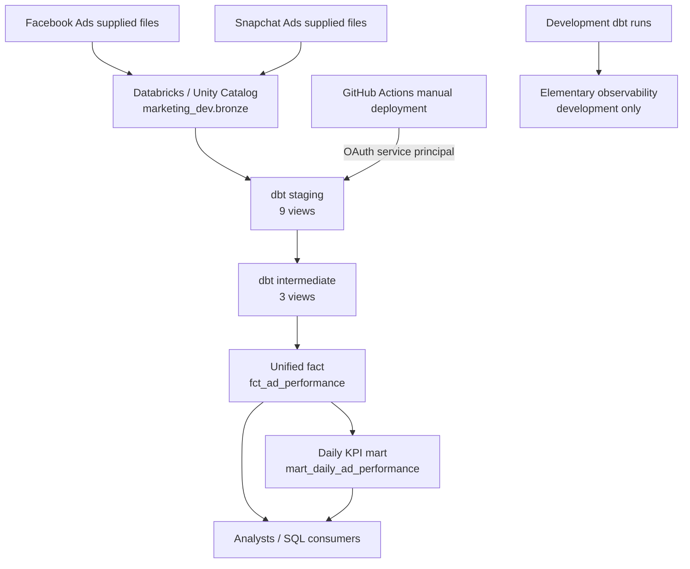

# Marketing Data Platform | Databricks + dbt

A production-minded, SQL-first marketing analytics data product that unifies Facebook Ads and Snapchat Ads reporting in Databricks. Built for the **Marketing Data Platform with Databricks & dbt** take-home case study.

## Business problem and outcome

Marketing performance was distributed across two advertising platforms, with different source structures and naming conventions. Comparing spend, clicks, impressions, and efficiency required manual exports and platform-specific knowledge. This project creates a governed, documented analytical layer for SQL users and future BI or AI consumers. **A dashboard is not implemented or required for the current deliverable.**

**Verified deployment snapshot (20 October 2026):** GitHub Actions manual dbt deployment succeeded; `marketing_dev.gold.fct_ad_performance` contains **95,109** rows and `marketing_dev.gold.mart_daily_ad_performance` contains **758** rows. These are point-in-time validation results, not hard-coded expectations.

## Technology stack

- **Databricks** SQL warehouse, Delta/Unity Catalog managed data, SQL editor
- **dbt Core + dbt-databricks** for source-to-mart SQL transformations, lineage, and testing
- **dbt_utils** for multi-column uniqueness tests
- **Elementary** for dbt observability in the development target
- **Python 3.12+ and uv** for reproducible project dependencies
- **GitHub Actions** for code validation and manually triggered deployment
- **Databricks service principal (`marketing-dbt-ci`)** for machine-to-machine deployment authentication

## Architecture at a glance



For the exact model dependencies, schema mapping, security model, and engineering trade-offs, see **[Architecture](docs/ARCHITECTURE.md)**.

## Source data and output models

Nine raw tables are registered as dbt sources in `marketing_dev.bronze`:

| Platform | Source tables |
| --- | --- |
| Facebook | `fb_accounts`, `fb_campaigns`, `fb_adgroups`, `fb_ads`, `fb_ads_stats` |
| Snapchat | `snapchat_campaigns`, `snapchat_adgroups`, `snapchat_ads`, `snapchat_ads_stats` |

The project contains **14 business models**: nine staging views, three intermediate views, and two Gold tables.

| Gold model | Grain | Purpose |
| --- | --- | --- |
| `fct_ad_performance` | Facebook: ad + account + reporting date; Snapchat: ad + reporting date + country + currency + source identifier (as represented by source uniqueness tests) | Unified detail-level advertising facts, names, IDs, spend, impressions, clicks |
| `mart_daily_ad_performance` | Platform + reporting date + currency | Daily totals, record counts, completeness flags, CTR, CPC, CPM |

**Important:** The fact retains platform-specific dimensions as nullable fields; for example, Facebook has `account_id` and Snapchat has `country_code` / `data_source`. Do not interpret missing platform-inapplicable fields as data defects.

## Business definitions and limitations

- **Spend:** original source currency, without exchange-rate conversion. Group or filter by `currency_code` before comparing monetary values.
- **Impressions / clicks:** raw source counts; some source rows have missing metrics.
- **CTR (%)** = `clicks / impressions * 100`, only when clicks and impressions are complete and impressions > 0.
- **CPC** = `spend / clicks`, only when clicks are complete and clicks > 0.
- **CPM** = `spend / impressions * 1000`, only when impressions are complete and impressions > 0.
- **Missing vs zero:** `NULL` means unknown/unavailable; zero means a recorded zero. The daily mart intentionally suppresses unreliable KPIs instead of assuming missing observations equal zero.
- **No currency conversion:** cross-platform *spend* comparisons must be partitioned by currency; no single combined-currency total is valid.
- **Snapshot attribution:** Snapchat ad groups use the latest available ad-group metadata, not a historical as-of join. Campaign attribution for older activity can therefore reflect current metadata.
- **Data loading:** the case study's supplied files were loaded into Databricks before dbt processing. The repository contains transformations and source declarations, **not an automated ingestion pipeline**.

See **[Validation and business questions](docs/VALIDATION.md)** for runnable SQL examples and an evidence checklist.

## Repository structure

```text
.github/
  ci/profiles.yml                  # Placeholder profile for offline parse validation
  deploy/profiles.yml              # OAuth service-principal profile
  workflows/dbt-ci.yml            # Push / PR: dependencies and dbt parse
  workflows/dbt-deploy.yml        # Manual: dbt build + tests in Databricks
  workflows/dbt-deploy-test.yml   # Manual: OAuth and connection diagnostic
marketing_dbt/
  dbt_project.yml
  packages.yml
  macros/generate_schema_name.sql
  models/sources.yml
  models/staging/                   # 9 models
  models/intermediate/              # 3 models
  models/marts/                     # 2 models
  tests/                            # 3 singular data tests
  README.md                         # dbt-specific quickstart
docs/
  ARCHITECTURE.md
  VALIDATION.md
pyproject.toml
uv.lock
README.md
```

## Local setup

Prerequisites: Git, Python 3.12+, `uv`, Databricks workspace access, an available SQL warehouse, and suitable Unity Catalog permissions. Local development authentication is **interactive OAuth** configured outside Git. Never commit tokens, OAuth secrets, or a personal `profiles.yml`.

From the repository root:

```powershell
uv sync --frozen
cd marketing_dbt
uv run dbt deps
uv run dbt debug
uv run dbt parse
uv run dbt build --select package:marketing_dbt
```

The `dbt debug` and `dbt build` commands above use your locally configured `~/.dbt/profiles.yml`; check that its target and catalog are correct before running. `dbt build` executes SQL and may create/replace relations in the selected development schemas. Do not run the deploy target locally using dummy credentials.

To generate and browse dbt's static HTML documentation locally:

```powershell
uv run dbt docs generate
uv run dbt docs serve
```

`dbt docs generate` creates `target/index.html`, `manifest.json`, and `catalog.json` in the dbt project; generated artifacts are not currently checked into the repository. The dbt docs UI exposes source-to-model lineage. To submit a generated static artifact, generate and attach it separately if the reviewer expects an actual HTML file rather than reproducible generation commands.

## Environment separation

| Context | Target/profile | Catalog | Business-model schemas | Execution |
| --- | --- | --- | --- | --- |
| CI | `ci` / `.github/ci/profiles.yml` | `marketing_ci` placeholder | Parse-only; no relations created | On push and PR to `main` |
| Development | Local OAuth profile (`default` schema) | `marketing_dev` | `default_silver`, `default_gold` | Developer-run dbt |
| Deployment / production-like | `deploy` / `.github/deploy/profiles.yml` | `marketing_dev` | `silver`, `gold` | Manually triggered GitHub Actions |

**Qualification:** `marketing_dev` is shared by development and production-like deployment, with **schema-level separation**, not separate production and development catalogs or workspaces. This is a deliberate scope/cost trade-off and should not be described as physically isolated production.

The custom `generate_schema_name` macro maps `+schema: silver/gold` to `default_silver/default_gold` in development and exactly `silver/gold` in the `deploy` target. See the architecture guide for details.

## CI/CD and secure deployment

- **CI (`dbt-ci.yml`)** runs on pushes and pull requests targeting `main`: `uv sync --frozen`, `dbt deps`, and `dbt parse` using placeholder credentials. It **does not run live database builds or data tests**.
- **Connection test (`dbt-deploy-test.yml`)** manually verifies Databricks OAuth and `dbt debug`.
- **Deployment (`dbt-deploy.yml`)** is manually triggered, authenticates using `DATABRICKS_HOST`, `DATABRICKS_CLIENT_ID`, and `DATABRICKS_CLIENT_SECRET` from GitHub Secrets, then runs `dbt build --profiles-dir ../.github/deploy --target deploy --select package:marketing_dbt`. `dbt build` builds selected business models and runs their tests.
- Deployment credentials belong to `marketing-dbt-ci`, not a personal access token. Bronze is read-only to the deployment identity; output permissions are granted on deployment schemas. Grant analysts only the access they need.
- **Elementary is intentionally disabled on `deploy`** by `models.elementary.+enabled`; it is configured in development. Deployment does not publish an Elementary report.

Manual deployment has been verified successful. Automatic post-merge deployment, a separate production catalog, live CI testing, and production Elementary monitoring are **not currently implemented**.

## Testing and observability

Schema YAML files contain not-null, accepted-values, uniqueness and composite-key tests. Three singular SQL tests validate (1) daily completeness flags, (2) KPI suppression when data is incomplete, and (3) fact-to-daily aggregation reconciliation. See `marketing_dbt/tests/`.

Elementary package version `0.25.1` and Elementary CLI dependency are configured. In development, the CLI report was successfully generated and showed **46 passed tests and 14 healthy tables** in the observed run. This is evidence from that run, not a claim of continuous monitoring. Example:

```powershell
cd marketing_dbt
uv run dbt run --select elementary
uv run dbt build
uv run edr report
```

Elementary may need its development tables initialized before reporting. Historical visibility grows as runs accumulate. The repository does not currently schedule reports or send alerts.

## Validation evidence

- GitHub Actions manual deployment: **passed** (observed 20 October 2026).
- `marketing_dev.gold.fct_ad_performance`: **95,109 rows**.
- `marketing_dev.gold.mart_daily_ad_performance`: **758 rows**.
- Dev model/test build previously passed; exact pass counts can differ depending on whether Elementary package tests are included.
- Full KPI query results and acceptance checklist: **[docs/VALIDATION.md](docs/VALIDATION.md)**. Queries are provided, but their outputs should be captured before marking each business question independently verified.

## Design decisions and future improvements

- **Views** in staging/intermediate avoid copying small-to-moderate datasets while keeping logic modular; **tables** in Gold support repeatable downstream querying. Incremental processing was considered but **not implemented**, since full rebuilds were practical for the supplied dataset and simplify correctness.
- The two platforms are standardized via a shared fact schema; platform-only columns remain nullable rather than fabricating values.
- Future enhancements: automated ingestion, incremental/partitioned refresh for growing volume, live data tests on pull requests, separately governed production catalog, CI artifact retention, production observability/alerting, currency FX normalization where required, and optional BI consumption.

## Case-study compliance

This project implements the central data product and its secure manual deployment. **[Validation](docs/VALIDATION.md)** explicitly distinguishes completed work, evidence still to collect, and scope limitations. Do not treat future enhancements as implemented features.
