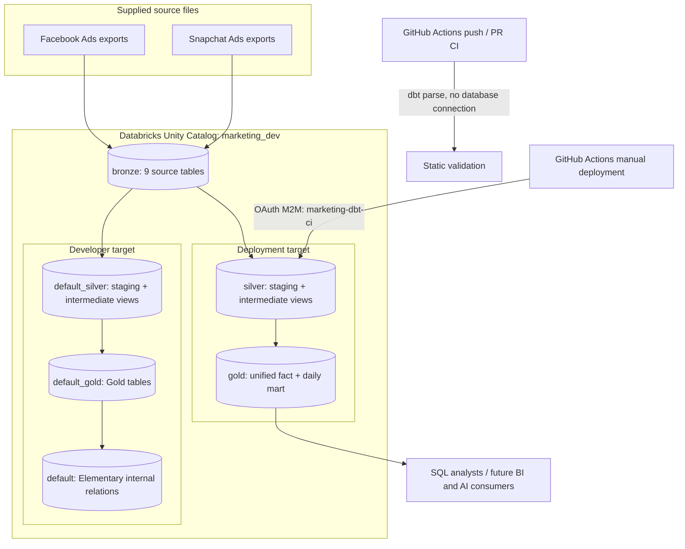

# Architecture and Engineering Decisions

## 1. Design objectives

Unify Facebook and Snapchat advertising reporting into a reusable, trustworthy SQL data product. Separate raw inputs from source normalization, enrichment, and business-facing aggregates; preserve original metric semantics; provide lineage, tests, and a controlled deployment identity.

## 2. Physical architecture



**Terminology:** The deploy target is *production-like* for this case study, but shares the `marketing_dev` catalog with development. It is logically isolated by schemas; it is not a separate production workspace/catalog. The provided source files were loaded to Bronze before the dbt transformations; file ingestion is not automated in this repository.

## 3. Source inventory

| dbt source | Physical table | Downstream staging model |
| --- | --- | --- |
| `facebook` | `fb_accounts` | `stg_facebook__accounts` |
| `facebook` | `fb_campaigns` | `stg_facebook__campaigns` |
| `facebook` | `fb_adgroups` | `stg_facebook__adgroups` |
| `facebook` | `fb_ads` | `stg_facebook__ads` |
| `facebook` | `fb_ads_stats` | `stg_facebook__ads_stats` |
| `snapchat` | `snapchat_campaigns` | `stg_snapchat__campaigns` |
| `snapchat` | `snapchat_adgroups` | `stg_snapchat__adgroups` |
| `snapchat` | `snapchat_ads` | `stg_snapchat__ads` |
| `snapchat` | `snapchat_ads_stats` | `stg_snapchat__ads_stats` |

All are declared in `marketing_dbt/models/sources.yml` under `marketing_dev.bronze`.

## 4. Logical lineage


### Staging: nine views

Staging performs source-facing renaming and casts: IDs to strings, dates/timestamps to typed values, spend to `decimal(18,2)` via `try_cast` where present, impressions/clicks to `bigint`, and standard aliases such as `ad_id`, `currency_code`, `spend`, `impressions`, and `clicks`. Source values that cannot be `try_cast` become `NULL`, rather than causing the entire staging query to fail; data quality checks and reporting completeness must therefore surface gaps.

### Intermediate: three views

**`int_facebook__ad_performance`** starts with Facebook ad statistics, left joins ads on `(ad_id, account_id)`, then campaigns, ad groups, and accounts. It brings in advertising names, campaign/ad-group IDs, account currency, and metrics. Using left joins prioritizes retaining fact records even if some descriptive metadata is absent.

**`int_snapchat__latest_adgroups`** ranks records by `updated_at DESC, ad_group_record_id DESC` within each `ad_group_id`, retaining one latest record. The second sort key makes ties deterministic. This prevents joining all historical ad-group versions and multiplying Snapchat metrics. **Caveat:** this is a current-state enrichment, not a date-effective historical mapping.

**`int_snapchat__ad_performance`** starts from Snapchat stats, left joins ads, the latest ad-group lookup, and campaigns. Snapchat provides `country_code` and `data_source` dimensions directly in stats.

### Gold: two tables

**`fct_ad_performance`** aligns Facebook and Snapchat records with `UNION ALL` and a common column order. Facebook-specific account fields are null for Snapchat; Snapchat-only country/source fields are null for Facebook. No conversion of currencies and no imputation of missing clicks/impressions occur.

**`mart_daily_ad_performance`** groups by `(platform, ad_date, currency_code)` and calculates `total_spend`, `total_impressions`, `total_clicks`, `performance_records`, missing-metric record counts, completeness flags, CTR, CPC, and CPM. It is a summary for platform/day/currency analysis, **not a campaign-level aggregate**; campaign ranking must query the fact table.

## 5. Grain, keys, and join correctness

| Model | Intended grain / key | Caveat |
| --- | --- | --- |
| `stg_facebook__*` | Source entity keys; see each model YAML | Exact uniqueness varies by entity and source |
| `stg_snapchat__adgroups` | `ad_group_record_id` (historical versions retained) | `ad_group_id` is not unique until latest-record selection |
| `int_snapchat__latest_adgroups` | One row per `ad_group_id` | Latest metadata only |
| `int_facebook__ad_performance` | `ad_id`, `account_id`, `ad_date` | Composite uniqueness test in YAML |
| `int_snapchat__ad_performance` | `ad_id`, `ad_date`, `country_code`, `currency_code`, `data_source` | Preserve multiple countries/source slices |
| `fct_ad_performance` | `platform`, `ad_id`, `account_id`, `ad_date`, `country_code`, `currency_code`, `data_source` | Composite key contains nullable platform-inapplicable columns |
| `mart_daily_ad_performance` | `platform`, `ad_date`, `currency_code` | One row per daily platform/currency group |

The fact does **not** have one universal campaign/day row. This prevents double counting when multiple ads, accounts, or countries contribute to a campaign. The YAML tests assert composite uniqueness but are not database-enforced primary keys. Revisit test behavior if nullable composite key columns become problematic for new source distributions.

## 6. Metric definitions and data contracts

| Metric | Expression | Conditions |
| --- | --- | --- |
| `total_spend` | `SUM(spend)` | Within one currency only |
| `total_impressions` | `SUM(impressions)` | Can be partial if source rows have `NULL` |
| `total_clicks` | `SUM(clicks)` | Can be partial if source rows have `NULL` |
| `ctr_pct` | `ROUND(100 * total_clicks / NULLIF(total_impressions,0),2)` | Only if both clicks and impressions are complete |
| `cpc` | `ROUND(total_spend / NULLIF(total_clicks,0),2)` | Only if clicks are complete |
| `cpm` | `ROUND(1000 * total_spend / NULLIF(total_impressions,0),2)` | Only if impressions are complete |

`clicks_complete` is true when `missing_click_records = 0`; `impressions_complete` similarly checks impressions. Incomplete groups expose partial additive totals but suppress affected ratio metrics. **Important limitation:** the mart's KPI suppression checks clicks and impressions, but not a missing-spend completeness flag; future work could extend that control if spend nullability is material. Zero denominators are handled by `NULLIF`, producing `NULL` rather than division errors. The fact is the right level for drilling into campaigns, while the daily mart serves platform/date reporting.

**Currency governance:** `EUR` and `USD` are separate units. Summing their spend together without an FX rate would be mathematically possible but financially misleading. Present spend grouped by `currency_code`.

## 7. Data quality and observability

YAML tests cover required identifiers, accepted platform values, and composite uniqueness; `dbt_utils.unique_combination_of_columns` handles multi-column keys. Three singular tests provide business-focused assertions:

1. `assert_daily_completeness_flags`: flags match missing-record counts.
2. `assert_daily_kpi_completeness`: incomplete metrics never produce unsupported CTR/CPC/CPM values.
3. `assert_daily_performance_reconciliation`: fact and daily mart reconcile by platform/currency for record counts, spend (0.01 tolerance), impressions, and clicks.

`dbt build` runs selected model builds and associated tests; `dbt docs generate` produces model/source documentation and lineage. **Elementary** is installed and demonstrated for development; the observed report showed 46 passed tests and 14 healthy tables. It is disabled on the deployment target and has no automated alerting or production report publishing. Historical reports depend on accumulating repeated monitored runs.

## 8. Materialization decisions

- **Staging views:** minimize duplicate storage, preserve transparent transformations, and make source cleanup reusable.
- **Intermediate views:** reusable joins and deduplication without extra persisted copies at this data size.
- **Gold tables:** persist the unified fact and daily aggregates for stable downstream query performance.
- **Incremental:** considered but not implemented. With ~95k fact rows in the observed snapshot, full builds were operationally practical and simpler to verify. For larger or frequently refreshed inputs, add an incremental strategy with an explicit unique key, late-arriving updates, backfill rules, and a safe full-refresh procedure.
- **Ephemeral:** not used; explicit intermediate views improve inspection and debugging for this exercise.

## 9. Environments and schema naming

`marketing_dbt/macros/generate_schema_name.sql` overrides dbt's default schema naming:

```jinja

  {{ target.schema }}

  {{ custom_schema_name | trim }}

  {{ target.schema }}_{{ custom_schema_name | trim }}

```

| Target | Target schema | `+schema: silver` | `+schema: gold` |
| --- | --- | --- | --- |
| Local dev | `default` | `marketing_dev.default_silver` | `marketing_dev.default_gold` |
| Deploy | `deploy` | `marketing_dev.silver` | `marketing_dev.gold` |
| CI | `ci` | Resolved in a placeholder catalog for parse | Resolved for parse; no database writes |

`models.elementary.+enabled` is conditional on `target.name != 'deploy'`; development retains observability relations while deployment builds only business models. This is **logical environment separation within one catalog**, not physical production isolation.

## 10. CI/CD control plane


**Actual workflow behavior:**

- `.github/workflows/dbt-ci.yml`: push and PR triggers; static `dbt parse` only, no live SQL compilation, dbt build, or database data tests.
- `.github/workflows/dbt-deploy-test.yml`: manually verifies OAuth and dbt connectivity.
- `.github/workflows/dbt-deploy.yml`: manual `workflow_dispatch`; `uv sync`, `dbt deps`, `dbt build --profiles-dir ../.github/deploy --target deploy --select package:marketing_dbt`.


## 11. Security and governance

The deploy profile obtains host, client ID, and client secret from GitHub Actions Secrets via `env_var`. OAuth machine-to-machine authentication is used, not a personal access token. The `marketing-dbt-ci` service principal has SQL warehouse access, catalog/schema usage, Bronze read privileges, and sufficient write privileges on Silver/Gold for the verified deployment. 


## 12. Known limitations, risk register, and extensions

| Area | Current implementation | Impact / proposed next step |
| --- | --- | --- |
| Ingestion | Files loaded to Bronze outside this repository | Add repeatable ingestion with schema drift handling |
| Production isolation | Separate schemas, shared `marketing_dev` catalog | Separate catalogs/workspaces when scaling |
| CI | Parse-only | Add isolated CI schema and live `dbt build` on PRs |
| Deployment | Manual trigger | Add approval-controlled automatic deployment if desired |
| Elementary | Development only | Add scheduled observability and alerting if required |
| Currency | Original currency preserved | Governed FX table for consolidated spend |
| Historical dimensions | Latest Snapchat ad-group metadata | Add point-in-time joins / SCD history if required |
| Null spend | No explicit spend completeness flag in daily mart | Add spend completeness checks before claiming full totals |
| Documentation artifact | Locally generated dbt HTML | Export/attach static HTML if submission expects the artifact |
| Incremental processing | Full rebuild | Implement incremental with late-data strategy at scale |
| Dashboard | Not built | Optional downstream consumer, not core assignment |

